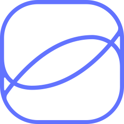

# Dodil for AI assistants

Connect Claude, ChatGPT, Cursor, VS Code, Gemini and other AI tools to
[Dodil](https://dodil.io), and build and run apps by asking. One Dodil
connection covers:

- **Data (K3):** buckets and tables with SQL, vector search, graph queries and
  S3 objects over the same rows, with ACID transactions.
- **Git and CI:** repositories, pull requests, issues and pipelines.
- **App hosting (Ignite):** deploy, scale and observe apps, with custom domains.
- **Sign-in for your apps (AppID):** user pools, tenants and service clients.
- **Your organization:** members, roles, service accounts and API keys.

This repository holds the listing files for each AI tool. The server itself is
hosted at `https://mcp.dodil.io`; there is nothing to install or run locally.

## Install

You sign in with your Dodil account the first time a tool is used, and choose
which organizations the AI tool may act in. Revoke access any time under
Connected apps in the Dodil console.

| Tool | Install |
|---|---|
| Claude (claude.ai, Desktop, mobile) | Settings → Connectors → add `https://mcp.dodil.io` |
| Claude Code | `/plugin marketplace add dodilio/dodil-mcp` then `/plugin install dodil@dodil` |
| ChatGPT | Apps → search for Dodil *(listing in review)* |

**Coming soon** (sign-in for these tools is being enabled):

| Tool | Install |
|---|---|
| Cursor | [Add to Cursor](cursor://anysphere.cursor-deeplink/mcp/install?name=dodil&config=eyJ1cmwiOiJodHRwczovL21jcC5kb2RpbC5pbyJ9) |
| VS Code | [Install in VS Code](https://vscode.dev/redirect?url=vscode%3Amcp%2Finstall%3F%257B%2522name%2522%253A%2522dodil%2522%252C%2522type%2522%253A%2522http%2522%252C%2522url%2522%253A%2522https%253A%2F%2Fmcp.dodil.io%2522%257D) · [VS Code Insiders](https://insiders.vscode.dev/redirect?url=vscode-insiders%3Amcp%2Finstall%3F%257B%2522name%2522%253A%2522dodil%2522%252C%2522type%2522%253A%2522http%2522%252C%2522url%2522%253A%2522https%253A%2F%2Fmcp.dodil.io%2522%257D) |
| Kiro | [Add to Kiro](https://kiro.dev/launch/mcp/add?name=dodil&config=%7B%22url%22%3A%22https%3A//mcp.dodil.io%22%7D) |
| Gemini CLI | `gemini extensions install https://github.com/dodilio/dodil-mcp` |
| OpenAI Codex CLI | `codex mcp add dodil --url https://mcp.dodil.io` then `codex mcp login dodil` |
| Goose | [Add to Goose](goose://extension?url=https%3A%2F%2Fmcp.dodil.io&type=streamable_http&id=dodil&name=Dodil&description=Build%20and%20run%20apps%20on%20Dodil) |

Prefer a local server? The [dodil CLI](https://docs.dodil.io) runs the same
tools on your machine with `dodil mcp`, using the sign-in from `dodil auth login`.

## What the assistant can do

Every tool is labelled read-only, write or destructive, so your AI tool can
ask before anything that deletes data, runs SQL that changes rows, deploys,
sends email or moves money. Tools act with your own roles in each
organization: the assistant can do no more than you can.

Examples to try:

- "Create a bucket called inventory with a products table, and load this CSV."
- "Which of my apps had errors in the last hour? Show me the logs."
- "Open a pull request on the web repo that bumps the API version."
- "Set up a sign-in pool for my app with Google login."

## Links

- Documentation: https://docs.dodil.io
- Privacy policy: https://dodil.io/legal/privacy
- Terms of service: https://dodil.io/legal/terms
- Support: support@dodil.io (or https://dodil.io/contact)

## License

The files in this repository are MIT licensed. Use of the Dodil service is
governed by the [terms of service](https://dodil.io/legal/terms).
